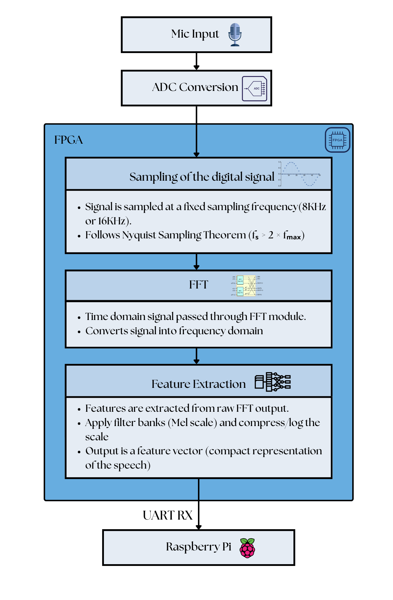
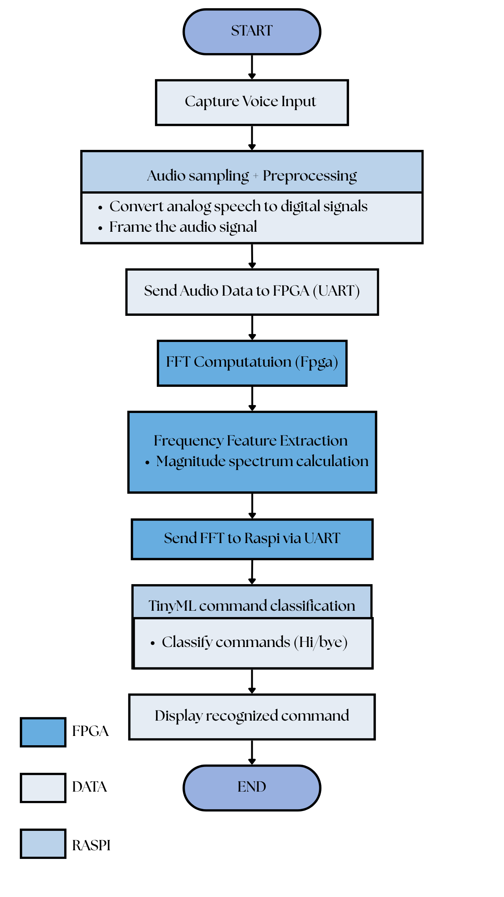
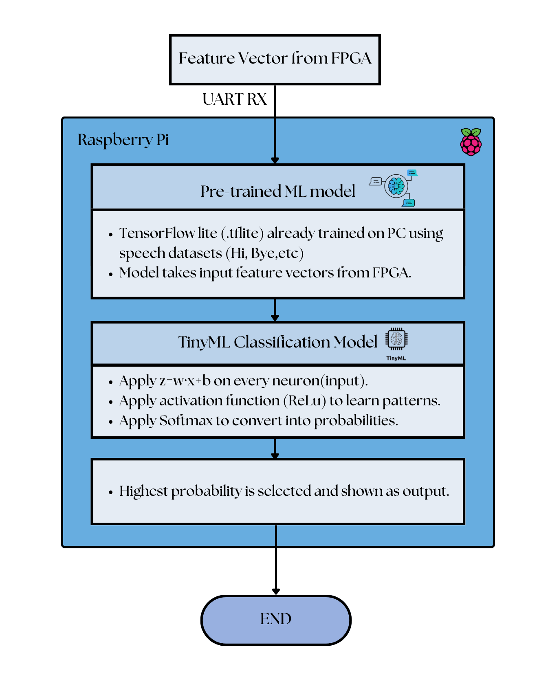
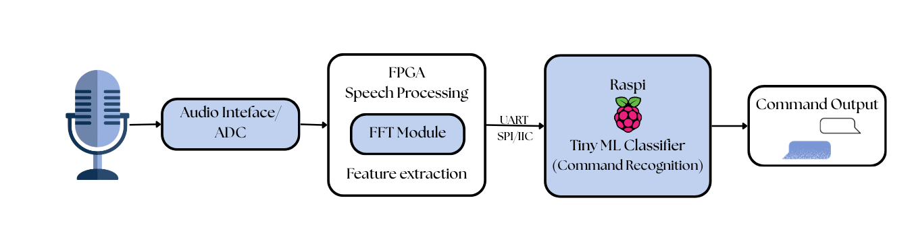
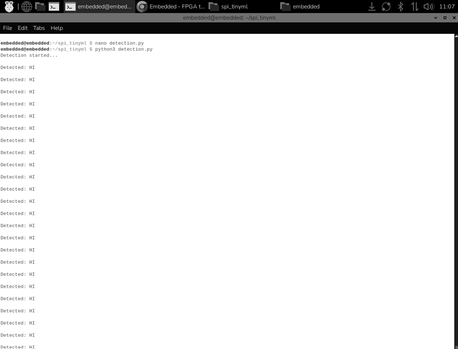

# Fpga-to-Raspi-Audio-Transmission

##  Project Overview

This project presents a hardware-software co-design architecture for low-latency keyword spotting[cite: 2]:
* **FPGA Acceleration (Xilinx MicroBlaze on Boolean Board):** Fetches speech samples from Block RAM (BRAM), executes a 64-point FFT in C, computes normalized frequency magnitudes, and streams features over SPI[cite: 2].
* **Raspberry Pi (TinyML Unit):** Operates as the SPI Master, collects frequency feature vectors, standardizes the input data, and runs an SVM classification model to recognize speech commands in real time[cite: 2].

---

## Background

### 1. Digital Signal Processing & FFT
Speech signals are non-stationary analog waveforms[cite: 2]. To process them on an FPGA, continuous signals $x(t)$ are sampled at a fixed sampling frequency $f_s \ge 2 f_{\text{max}}$ adhering to the Nyquist Sampling Theorem[cite: 2]:

$$x[n] = x(n T_s)$$

Because raw time-domain waveforms are difficult for lightweight machine learning models to classify, the Discrete Fourier Transform (DFT) converts the time-domain samples into spectral components[cite: 2]:

$$X[k] = \sum_{n=0}^{N-1} x[n] \cdot e^{-j \frac{2\pi}{N} k n}, \quad k = 0, 1, \dots, N-1$$

To reduce algorithmic complexity from $\mathcal{O}(N^2)$ to $\mathcal{O}(N \log N)$, a 64-point Fast Fourier Transform (FFT) algorithm (incorporating bit-reversal and butterfly computations) is implemented in C on the MicroBlaze soft-core processor[cite: 2].

### 2. Feature Scaling & Data Transmission
Following FFT computation, the magnitude of each frequency bin is calculated[cite: 2]:

$$\text{mag}[k] = \vert{}\text{Re}(X[k])\vert{} + \vert{}\text{Im}(X[k])\vert{}$$

To ensure efficient, low-overhead transmission over the 8-bit SPI bus, magnitude values are dynamic-range compressed and scaled from $0$ to $255$[cite: 2]:

$$\text{scaled}[k] = \frac{\text{mag}[k] \cdot 255.0}{\text{max\_val} + 10^{-6}}$$

Additionally, the DC component ($\text{spi\_tx}[0] = 0$) is zeroed out to prevent baseline bias during machine learning inference[cite: 2].

### 3. TinyML Classification
The Raspberry Pi receives the 64-element feature vector and normalizes the input data using saved training statistics (mean $\mu$ and standard deviation $\sigma$)[cite: 2]:

$$\hat{x} = \frac{x - \mu}{\sigma + 10^{-6}}$$

An RBF-kernel Support Vector Machine (SVM) evaluates the feature vector to calculate decision scores and class probabilities[cite: 2]. If the prediction confidence exceeds a set threshold, the identified keyword (e.g., "HI", "BYE", "HOW ARE YOU") is output to the console[cite: 2].

---

## 🏗 Microarchitecture & System Flow

### 1. FPGA Hardware Block Design

  
   
  
<em><b>Figure 1:</b> Vivado MicroBlaze Soft-Core Processor Block Design featuring AXI BRAM Controller and SPI Slave Peripheral[cite: 2].</em>

---

### 2. FPGA Processing Flow

  
   
  
<em><b>Figure 2:</b> FPGA Preprocessing Flowchart (ADC Sampling, 64-Point FFT Computation, and Feature Extraction)[cite: 2].</em>

---

### 3. Raspberry Pi TinyML Flow

  
   
  
<em><b>Figure 3:</b> Raspberry Pi Execution Flow (SPI Feature Acquisition, Model Inference, and Output Classification)[cite: 2].</em>

---

### 4. Lab Setup & Peripheral Interfacing

  
   
  
<em><b>Figure 4:</b> Peripheral Interfacing Setup for MPU6050 Testing and Raspberry Pi Operating System Environment Configuration[cite: 2].</em>

---

## 🚀 Execution & Results

### 5. Real-Time Detection Output

  
   
  
<em><b>Figure 5:</b> Raspberry Pi Terminal Displaying Live Speech Command Detection ("Detected: HI")[cite: 2].</em>

